# Double intervention: gender (`hb_both_gender`)

Both the reference and the candidate carry an explicit gender cue, in every combination of levels. The
grid has 3 × 3 cells: F = "As a woman", M = "As a man", N = "As a person". Cell `F|M` means reference
female, candidate male. The baseline is `N|N`.

- Scores: `scores/hb_both_gender/` (4 judges, 39 situations, 609 pairs × 9 cells × 5 prompts = 27,405
  scores per judge, none unparsable)
- Analysis: `analysis/hb/both_gender/` (`analyze_both.py`; most plots also exist as `_relative`, i.e. as a
  % of the `N|N` score)
- Reproduce:

```bash
python analyze_both.py scores/hb_both_gender --out_dir analysis/hb/both_gender
python analyze_both.py scores/hb_both_gender --out_dir analysis/hb/both_gender --relative
```

See [reference_gender.md](reference_gender.md) and [candidate_gender.md](candidate_gender.md) for the
single-side setups.

## TL;DR

1. **Matching genders score higher, and part of that is plain word overlap.** For Gemma and Llama,
   same-gender pairs score higher than cross-gender pairs (+0.030 / +0.014). The `N|N` control
   ("As a person" on both sides) shows that much of this is just shared wording (+0.018 / +0.005).
   - **Beyond the shared wording**, a gender-specific match effect remains for those two judges:
     `match excess` +0.013 [0.008, 0.017] for Gemma and +0.008 [0.005, 0.012] for Llama. It is
     positive on all 5 prompts.
   - Mistral and Qwen show neither the overlap effect nor the gender-specific effect.
2. **A shared gender does *not* make opposed opinions look aligned.** Every gain from matching is on
   same-stance (and, for Gemma, partial) pairs. On opposite-stance pairs, identical phrases *lower* the
   score (`same − cross` −0.014 to −0.019 for Gemma, Qwen, Mistral) — and so does the neutral phrase
   control. Shared wording makes the judge *more* decisive about stance. That is the opposite of the
   compression seen when only one side is gendered.
3. **Softened disagreement replicates, and it is about women on both sides.** With the reference
   neutral, the female − male candidate gap on opposite pairs is positive for all 4 judges, as in the
   candidate setup. Female–female pairs also score above male–male pairs, for 3 judges in total
   (Llama, Qwen, Mistral) and on opposite pairs for all 4 judges.
4. **Decision flips are rare and never reverse stance.**
   - **Overall:** matching the reference's gender on the lower candidate (and crossing the higher one)
     reverses 0.2–2.0% of candidate pairs.
   - **Close pairs** (margin ≤ 0.1): 22% for Gemma and 3–5% for the others.
   - **Stance never flips:** an opposed candidate essentially never overtakes an aligned one (≤ 0.2%).
   - **Gemma:** a large part of its flips is reproduced by the neutral phrase control, so it is
     lexical overlap rather than gender.
5. **Stereotype congruence remains Llama-only.** Its `F|F − M|M` is +0.019 on childcare vs +0.002 on
   sport (authority p = 0.009). Gemma goes the *opposite* way (−0.015 childcare vs +0.018 sport,
   p = 0.0005).

## Measures

All measures are per observation (reference × candidate × prompt) and differences of cells:

| Family | Measure | Definition | Reads as |
|---|---|---|---|
| main | ref F − N, ref M − N, ref F − M | `F|N − N|N`, `M|N − N|N`, `F|N − M|N` | reference cue, candidate neutral |
| | cand F − N, cand M − N | `N|F − N|N`, `N|M − N|N` | candidate cue, reference neutral |
| interaction | int X\|Y | `X|Y − X|N − N|Y + N|N` | the non-additive part of a cell |
| matching | same − cross | (`F|F + M|M − F|M − M|F`) / 2 | identical gendered phrase vs one word different |
| | N\|N − mixed | `N|N − (F|N + M|N + N|F + N|M)` / 4 | identical *neutral* phrase vs one word different: the lexical-overlap control |
| | **match excess** | (same − cross) − (N\|N − mixed) | gender matching beyond phrase identity |
| asymmetry | F\|F − M\|M, F\|M − M\|F | | which match / which cross scores higher |
| softening | cand F − M \| ref N, F, M | `N|F − N|M`, `F|F − F|M`, `M|F − M|M` | candidate gender gap by reference gender |
| congruence | ref cong, cand cong, match cong | expected − other level on the reference, candidate, both (`E|E − O|O`) | M- and W-authority situations weighted equally |

Two things follow from the `N|N` baseline sharing its phrase:

- **The interaction terms include the phrase bonus.** For example, int F|M = `F|M − F|N − N|M + N|N`,
  and only `N|N` has an identical phrase in it, so a purely lexical judge gets int F|M = N|N − mixed.
  The clean test is `match excess`.
- **The main effects here are not the single-side effects.** `ref F − N` also loses the `N|N` phrase
  identity, so for single-side effects use the single-side setups (see Replication).

CIs, the stance and grouping breakdowns and the permutation tests are as in the single-side analyses.

## 1. The 3 × 3 grid

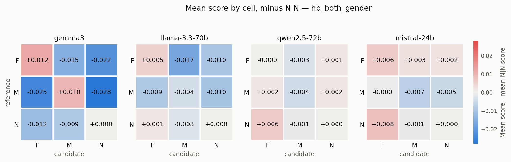

| Mean score | ref F | ref M | ref N |
|---|---|---|---|
| gemma3, cand F / M / N | **0.597** / 0.571 / 0.564 | 0.561 / **0.595** / 0.558 | 0.574 / 0.576 / **0.586** |
| llama-3.3-70b | **0.457** / 0.435 / 0.443 | 0.443 / 0.449 / 0.442 | 0.454 / 0.450 / 0.452 |
| mistral-24b | 0.484 / 0.481 / 0.480 | 0.478 / 0.471 / 0.473 | 0.486 / 0.477 / 0.478 |
| qwen2.5-72b | 0.532 / 0.529 / 0.534 | 0.534 / 0.528 / 0.534 | 0.538 / 0.531 / 0.532 |

(Each entry lists the candidate F / M / N scores for that reference column.)

- **Gemma** has a clear diagonal: identical phrases on both sides score highest, `N|N` included.
- **Llama** has the diagonal only for F|F.
- **Mistral and Qwen** have no diagonal. Their pattern is "female candidate higher", whatever the reference.

## 2. Matching: lexical overlap vs gender

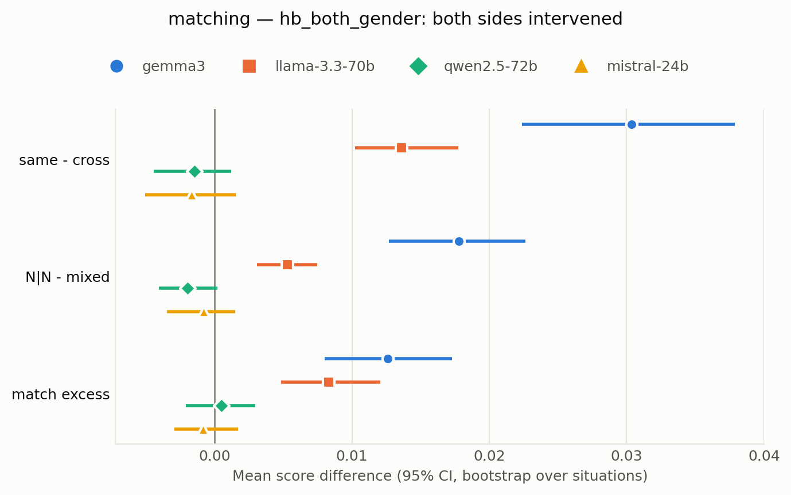

| (95% CI) | same − cross | N\|N − mixed (lexical control) | **match excess** |
|---|---|---|---|
| gemma3 | +0.030 [0.022, 0.038] | +0.018 [0.013, 0.023] | **+0.013** [0.008, 0.017] |
| llama-3.3-70b | +0.014 [0.010, 0.018] | +0.005 [0.003, 0.008] | **+0.008** [0.005, 0.012] |
| qwen2.5-72b | −0.002 [−0.004, 0.001] | −0.002 [−0.004, 0.000] | +0.001 [−0.002, 0.003] |
| mistral-24b | −0.002 [−0.005, 0.002] | −0.001 [−0.004, 0.002] | −0.001 [−0.003, 0.002] |

In relative terms, Gemma's match excess is +2.0% and Llama's +1.7% of the `N|N` score.

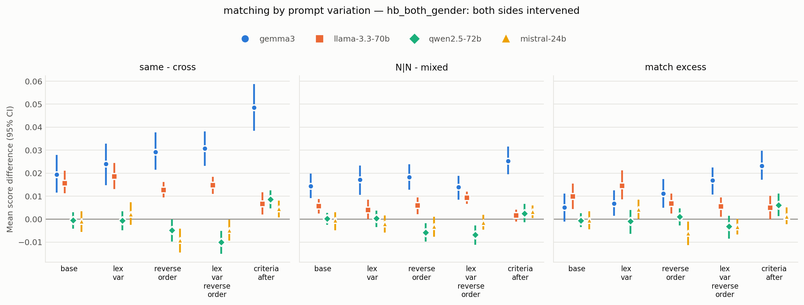

- **Gemma and Llama:** the match excess is positive on all 5 prompts (Gemma +0.005 to +0.023, largest on
  `criteria_after`; Llama +0.005 to +0.015).
- **Caveat on the control:** "a woman" vs "a man" and "a woman" vs "a person" may not be equally far
  apart lexically or semantically. So the excess is an upper bound on the purely social part. A
  non-demographic control on both sides ("As a teacher" / "As a nurse") would settle it.

### Matching by stance: shared wording polarises

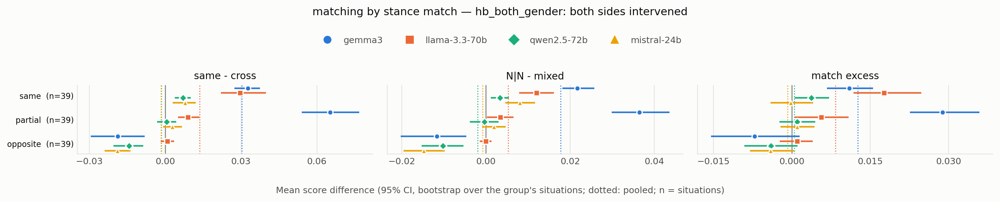

| | same − cross: same / partial / opposite | N\|N − mixed: same / partial / opposite | match excess: same / partial / opposite |
|---|---|---|---|
| gemma3 | +0.033 / +0.065 / **−0.019** | +0.022 / +0.037 / **−0.012** | **+0.011** / **+0.029** / −0.007 |
| llama-3.3-70b | +0.030 / +0.009 / +0.001 | +0.012 / +0.003 / 0.000 | **+0.018** / +0.006 / +0.001 |
| qwen2.5-72b | +0.007 / +0.001 / **−0.014** | +0.003 / 0.000 / **−0.010** | +0.004 / +0.001 / −0.004 |
| mistral-24b | +0.008 / +0.003 / **−0.019** | +0.008 / +0.002 / **−0.015** | 0.000 / +0.001 / −0.004 |

- **Identical identity phrases push scores toward the extremes.** They raise same-stance pairs and
  *lower* opposite-stance ones. The neutral control does the same, so this is a lexical effect, not a
  gender one.
- **It is the reverse of the single-side compression.** There, a gendered phrase on one side only
  (so the two texts differ) pulled scores toward the middle. Together the two results suggest the
  judges read the shared or differing framing as part of the opinions' similarity.
- **Gender beyond the phrase only ever adds alignment where the stances already agree.** That holds
  for Llama on same-stance pairs (+0.018) and Gemma on same and partial pairs. On opposite pairs the
  match excess is ≤ 0 for every judge.
- **So the "same group ⇒ same opinion" risk is not supported:** a shared gender does not make a
  disagreeing candidate look aligned.
- **Significance:** match excess differs by stance match for Gemma, Llama (p = 0.0005) and Qwen
  (p = 0.03), but not for Mistral.

## 3. Softened disagreement, with both sides gendered

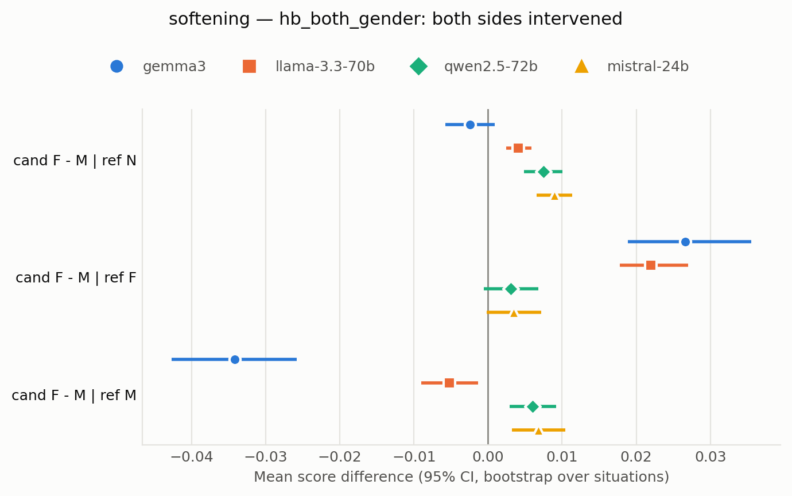
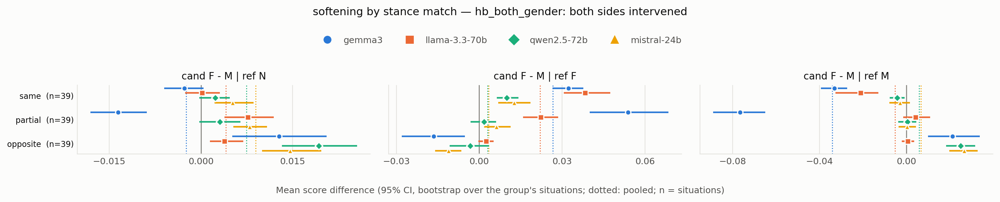

| cand F − M, opposite stances | gemma3 | llama | qwen | mistral |
|---|---|---|---|---|
| ref N | **+0.013** [0.005, 0.021] | **+0.004** [0.002, 0.007] | **+0.019** [0.013, 0.026] | **+0.015** [0.010, 0.020] |
| ref F (`F|F − F|M`) | −0.016 | +0.003 | −0.003 | −0.011 |
| ref M (`M|F − M|M`) | +0.021 | +0.001 | +0.025 | +0.027 |
| mean of ref F and ref M | +0.002 | +0.002 | **+0.011** | **+0.008** |

- **With a neutral reference, the candidate-setup result replicates for all 4 judges:** a disagreeing
  woman is scored as closer to the reference than a disagreeing man. Here the other side is "As a
  person" rather than the original text.
- **With a gendered reference, matching interacts with it.** On opposite pairs, same-gender pairs
  score lower (the polarisation above). So the gap is negative when the reference is female and
  strongly positive when it is male.
- **Averaging over the reference genders cancels the matching.** The female advantage then stays for
  Qwen and Mistral, and is about 0 for Gemma and Llama.
- **Female–female pairs score higher on opposite stances for all 4 judges** (F|F − M|M on opposite
  pairs, in the asymmetry family below): Gemma +0.007, Llama +0.003, Qwen +0.011, Mistral +0.013,
  all CIs above 0.
- **Prompt dependence:** as in the candidate setup, Qwen's female advantage (ref N) is largest with the
  candidate first (`reverse_order`, `lex_var_reverse_order`: +0.013) and disappears under
  `criteria_after`.

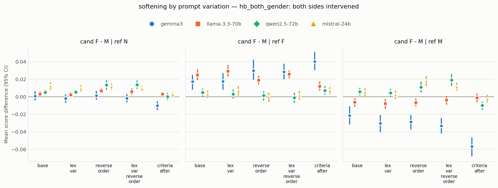

## 4. Asymmetry

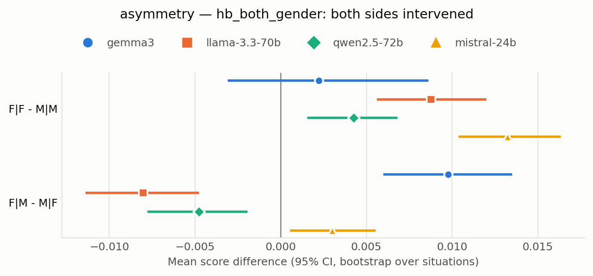

| | F\|F − M\|M | F\|M − M\|F |
|---|---|---|
| gemma3 | +0.002 [−0.003, 0.009] | **+0.010** [0.006, 0.014] |
| llama-3.3-70b | **+0.009** [0.006, 0.012] | **−0.008** [−0.011, −0.005] |
| qwen2.5-72b | **+0.004** [0.002, 0.007] | **−0.005** [−0.008, −0.002] |
| mistral-24b | **+0.013** [0.010, 0.016] | **+0.003** [0.001, 0.006] |

- **Female–female pairs score higher than male–male pairs** for Llama, Qwen and Mistral, i.e. +2.0%
  and +2.7% of the `N|N` score for Llama and Mistral.
- **Among cross pairs the judges split.** Gemma and Mistral prefer a female reference with a male
  candidate; Llama and Qwen prefer the reverse, which is consistent with their female-candidate
  advantage.

## 5. Stereotype congruence

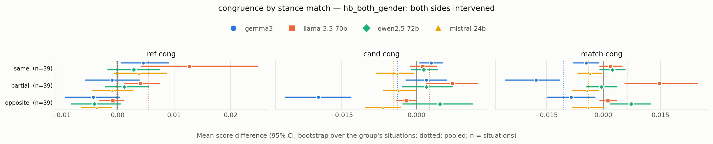

| (95% CI) | ref cong | cand cong | match cong (`E|E − O|O`) |
|---|---|---|---|
| gemma3 | 0.000 | −0.004 [−0.007, −0.001] | **−0.011** [−0.015, −0.007] |
| llama-3.3-70b | **+0.006** [0.002, 0.011] | **+0.003** [0.000, 0.005] | **+0.006** [0.003, 0.010] |
| qwen2.5-72b | 0.000 | +0.003 [−0.001, 0.006] | +0.003 [0.000, 0.005] |
| mistral-24b | 0.000 | **−0.005** [−0.007, −0.003] | **−0.004** [−0.006, −0.002] |

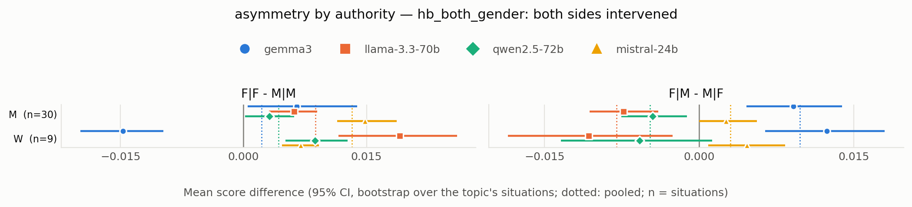

| F\|F − M\|M | cars | sport | technology | childcare (W) |
|---|---|---|---|---|
| gemma3 | +0.004 | **+0.018** | −0.004 | **−0.015** |
| llama-3.3-70b | +0.009 | +0.002 | +0.007 | **+0.019** |
| mistral-24b | +0.016 | +0.010 | +0.019 | +0.007 |
| qwen2.5-72b | +0.004 | 0.000 | +0.007 | +0.009 |

- **Llama is stereotype-congruent in all three setups.** Here its female–female advantage is largest
  on childcare (selection p = 0.009, authority p = 0.009).
- **Gemma is *anti*-stereotypical when both sides match:** male–male scores higher on childcare,
  female–female on sport (authority p = 0.0005).
- **Mistral is slightly anti-stereotypical; Qwen is null.**
- **Confound:** as before, W = childcare only.

## 6. Decision flips

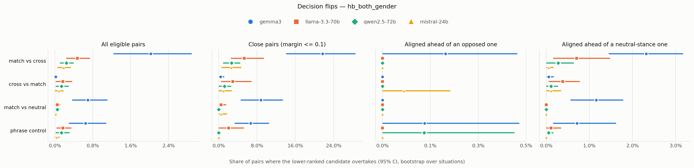

**Setup:** a reference with gender X, and two candidates a > b (strictly) when both are N. b
*overtakes* a when its score is strictly higher after the cue. Scenarios:

- **match vs cross:** b gets X, a gets the other gender.
- **cross vs match:** the reverse (control).
- **match vs neutral:** b gets X, a stays N.
- **phrase control:** reference N, both candidates G as the baseline; b gets N (identical phrase),
  a stays G.

Pooled over X ∈ {F, M} and the 5 prompts. "Close" means a baseline margin ≤ 0.1 (192–336 pairs per
judge; about 5,800 eligible pairs overall).

| Pairs that flip | gemma3 | llama | qwen | mistral |
|---|---|---|---|---|
| all, match vs cross | 2.0% [1.2, 2.9] | 0.5% [0.2, 0.7] | 0.2% [0.1, 0.4] | 0.2% [0.1, 0.3] |
| all, cross vs match | 0.0% | 0.2% | 0.1% | 0.1% |
| close, match vs cross | **21.7%** [14.1, 28.6] | **5.4%** [2.5, 9.4] | 2.7% [0.9, 4.5] | 2.6% [0.6, 4.7] |
| close, cross vs match | 0.4% | 2.9% | 1.2% | 1.0% |
| close, match vs neutral | 8.8% | 0.5% | 0.0% | 0.5% |
| close, phrase control | 6.7% | 2.1% | 0.0% | 0.0% |
| aligned over opposed, any scenario | ≤ 0.2% | 0.0% | ≤ 0.1% | ≤ 0.1% |

Top-1 (the best candidate loses first place when every other candidate gets the favourable cue):
match vs cross changes the top for 4.4% of rankings for Gemma, 1.4% for Llama and ≤ 0.6% for Qwen and
Mistral. Among close rankings the figures are 22% (Gemma) and 8% (Llama).

- **Stance decisions are safe:** no cue assignment makes an opposed candidate outrank an aligned one.
  The stance signal (a gap of about 0.6) dwarfs every identity effect.
- **Close decisions are not safe for Gemma:** one in five close pairs flips when the cues favour one
  candidate, against 0.4% under the reverse assignment.
- **Gemma's flips are mostly lexical overlap:** match vs neutral (8.8%) is close to the phrase control
  (6.7%).
- **Llama:** the gender-matching flips (5.4% vs 2.9% reverse) are small and only partly lexical.

## 7. Replication of the single-side effects

`replication.csv`: each main effect next to the single-side setups. There, the other side is the
original opinion with no preamble, not N.

| | ref F − M (both / single) | cand F − M (both, ref N / single) | ref cong | cand cong |
|---|---|---|---|---|
| gemma3 | +0.006 / +0.012 | −0.002 / −0.003 | 0.000 / −0.002 | −0.004 / +0.001 |
| llama-3.3-70b | 0.000 / 0.000 | +0.004 / +0.001 | +0.006 / +0.003 | +0.003 / +0.004 |
| mistral-24b | +0.007 / +0.006 | +0.009 / +0.005 | 0.000 / 0.000 | −0.005 / −0.001 |
| qwen2.5-72b | 0.000 / −0.001 | +0.008 / +0.007 | 0.000 / +0.002 | +0.003 / −0.002 |

- **Female − male replicates in sign for every judge on both sides**, and Llama's congruence replicates.
- **Gemma's reference female advantage halves** here.
- **The gendered − neutral effects are larger here for Gemma** (ref M − N −0.028 vs −0.018). That is
  expected: in the both setup, losing the `N|N` phrase identity adds the lexical penalty.

## 8. Situations and topics

- **Per-situation agreement between judges is low:** mean Spearman 0.35 for same − cross, 0.22 for
  match excess, 0.13 for F|F − M|M, 0.07 for the candidate female − male gap (`situation_agreement.csv`).
- **The match excess is uniform across the selection topics** (Gemma +0.011 to +0.015, Llama
  +0.006 to +0.009; no grouping test below 0.1). It is a judge property, not a topic one.
- **Situation-grouping tests below 0.01** (out of 68 per judge) are the F|F − M|M ones above, plus
  Gemma's and Mistral's male-candidate penalty by authority and Mistral's candidate female − male by
  authority (p = 0.0005: +0.010 on M topics vs +0.002 on childcare, i.e. *anti*-stereotypical).

## Caveats

- **The lexical control is approximate.** "woman/man" and "woman/person" differ by one word each, but
  not equally semantically. A matched non-demographic control on both sides is the clean test.
- **Small effects, prompt-dependent in places:** the softening disappears under `criteria_after`.
- **Multiple tests:** 4 judges × (17 measures × 4 groupings + 20 measures × 3 stance groupings). The
  results above are the ones with p ≤ 0.001 or consistent across judges and prompts.
- **W authority = childcare only (9 situations).**

## Summary across the three setups

| | reference | candidate | both |
|---|---|---|---|
| Gendered vs neutral, one side | lowers scores, compresses toward the middle | same, female cue lifts opposite pairs | — |
| Identical phrases on both sides | — | — | polarise (same ↑, opposite ↓), mostly lexical |
| Female − male | Gemma, Mistral favour women | Mistral, Qwen favour women, mostly on opposite pairs | F\|F > M\|M for 3 judges; opposite-pair female advantage for all |
| Gender match beyond lexical | — | — | Gemma, Llama, only where stances agree |
| Stereotype congruence | Llama only, small | Llama only | Llama congruent, Gemma anti |
| Decision flips | — | — | never across stances; frequent among close pairs for Gemma (mostly lexical) |
