# Reference intervention: gender (`hb_reference_gender`)

Does an LLM judge change the alignment score between a reference opinion and a candidate opinion when
the only change is an explicit gender cue on the **reference** ("As a woman, ..." / "As a man, ..." /
"As a person, ...")?

- Scores: `scores/hb_reference_gender/` (4 judges)
- Analysis: `analysis/hb/reference_gender/` (all plots below also exist as PDF and as `_relative` versions)
- Reproduce:

```bash
python analyze.py scores/hb_reference_gender --out_dir analysis/hb/reference_gender
python analyze.py scores/hb_reference_gender --out_dir analysis/hb/reference_gender --relative
```

The outputs of the earlier HBY run (`scores/reference_gender`, 500 situations) are in
`analysis/old/reference_gender/`.

## TL;DR

1. **Naming a gender lowers the score** compared with "a person", for every judge (by about 1–3% of the score).
2. **The cue compresses scores toward the middle.** It lowers pairs whose stances agree (high scores) and
   slightly raises pairs whose stances are opposite (low scores). All 4 judges show it, and the stance
   groups differ beyond chance (p ≤ 0.001).
3. **Gemma and Mistral favour female over male references** (+0.012 / +0.006, i.e. +2.1% / +1.3%), on every
   prompt variation and every selection topic. Llama and Qwen show no female − male gap.
4. **There is little evidence of stereotype-congruent scoring**: the authority-balanced congruent − incongruent
   contrast is about 0. Only Llama shows a small positive effect (+0.003).
5. **All these effects are 3–6× smaller than prompt sensitivity**: changing only the prompt wording moves
   the score more than changing the gender.

## Data

| | |
|---|---|
| Situations | 39 Habermas Machine questions, manually selected where gender stereotypes are likely to play a role |
| Selection topics | cars (12), sport (10), childcare (9), technology (8) |
| Expected authority | M: cars, sport, technology (30); W: childcare (9) |
| References | 203 human opinions, about 5 per situation (1–6), × 3 levels (female, male, neutral) |
| Candidates | 3 synthetic opinions per situation (agree / disagree / neutral), not intervened |
| Pairs × prompts | 609 pairs × 3 levels × 5 prompt variations = 9,135 scores per judge, none unparsable |
| Judges | gemma3, llama-3.3-70b, qwen2.5-72b, mistral-24b |

Reference stances: 318 pairs with an agreeing reference, 204 disagreeing, 87 neutral.
`gender_role_reference` and `heteronormative` are False for every HB situation, so they are not used.

## Method

What changed from the earlier HBY analysis is marked *(new)*.

- **Item:** a pair of original opinions (reference × candidate). Its versions differ by the level of the
  reference and by the prompt variation.
- **Unsigned variation:** the mean absolute score difference, and the share of score pairs that change,
  across three factors:
  - prompt: the 5 prompt variations, level fixed;
  - levels: female vs male, prompt fixed;
  - cue: each gender vs neutral, prompt fixed.
- **Signed gaps:** female − neutral, male − neutral, female − male, with the prompt fixed.
- **Congruent − incongruent *(new)*:** the score of the gender the stereotype expects in the situation
  (M → male, W → female) minus the score of the other gender. The M and W situations get equal weight,
  and the bootstrap is stratified by authority. This cancels any gap shared by all situations; it equals
  ((f − m | W) − (f − m | M)) / 2. Positive means the judge favours the stereotype-expected gender.
- **Uncertainty:**
  - 95% CIs by bootstrap over situations (1,000 resamples).
  - Per-situation SEs clustered by reference.
  - The heterogeneity tests are permutation tests (2,000 permutations).
- **Groupings *(new)*:**
  - Situation-level: manual `selection_topic`, `expected_authority`, and the Habermas topic domain and subdomain.
  - Stance-level: the reference's stance, the reference → candidate stance pair (9 cells), and the
    stance match (same / partial = one side neutral / opposite).
  - Stance varies within a situation, so the stance test shuffles stance labels **within** each situation.
- **Relative mode:** for each situation, its mean difference divided by its mean baseline (neutral)
  score, then averaged over situations.

## 1. Prompt vs gender: how much does the score move?

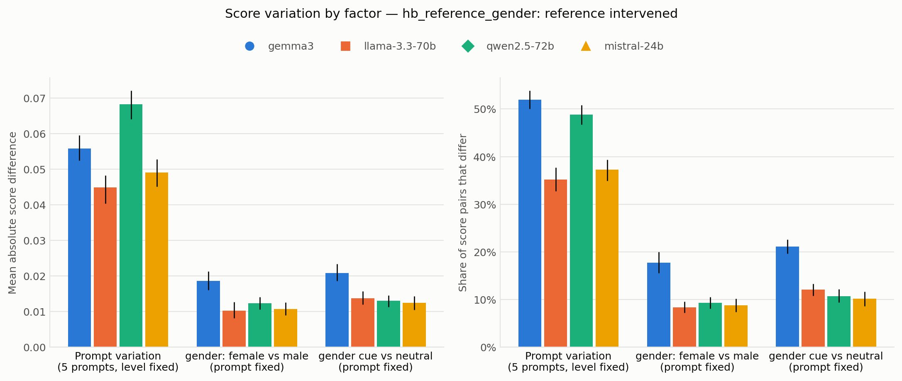

| Mean abs. difference | prompt | female vs male | cue vs neutral |
|---|---|---|---|
| gemma3 | 0.056 | 0.019 | 0.021 |
| llama-3.3-70b | 0.045 | 0.010 | 0.014 |
| mistral-24b | 0.049 | 0.011 | 0.013 |
| qwen2.5-72b | 0.068 | 0.012 | 0.013 |

- The prompt variation moves the score 3–6× more than the gender cue. In relative terms that is about
  10–13% of the score for the prompt, against 2–4% for gender.
- The gender cue changes 8–21% of the scores at all, against 35–52% for the prompt. Gemma is the most
  sensitive to gender.
- Part of the gender variation is vLLM batching noise (about 3% of answers change between layouts, see
  the README). That noise is symmetric, so it inflates the unsigned measures but does not bias the signed gaps.

## 2. Signed gaps (pooled over prompts)

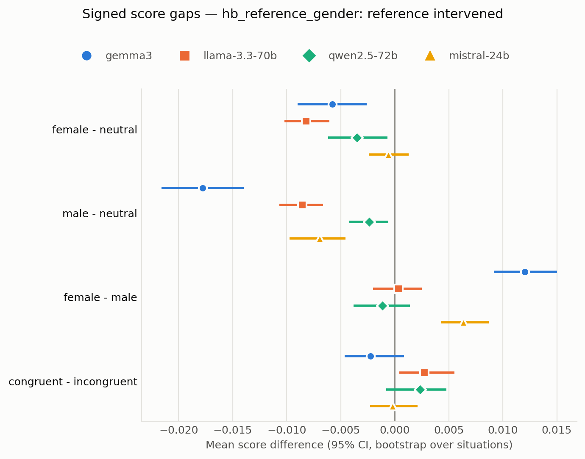

| Gap (95% CI) | female − neutral | male − neutral | female − male | congruent − incongruent |
|---|---|---|---|---|
| gemma3 | −0.006 [−0.009, −0.003] | **−0.018** [−0.022, −0.014] | **+0.012** [0.009, 0.015] | −0.002 [−0.005, 0.001] |
| llama-3.3-70b | −0.008 [−0.010, −0.006] | −0.009 [−0.011, −0.007] | 0.000 [−0.002, 0.003] | +0.003 [0.000, 0.006] |
| mistral-24b | −0.001 [−0.002, 0.001] | −0.007 [−0.010, −0.005] | +0.006 [0.004, 0.009] | 0.000 [−0.002, 0.002] |
| qwen2.5-72b | −0.004 [−0.006, −0.001] | −0.002 [−0.004, −0.001] | −0.001 [−0.004, 0.001] | +0.002 [−0.001, 0.005] |

Relative to the neutral score:

| | female − neutral | male − neutral | female − male |
|---|---|---|---|
| gemma3 | −1.0% | −3.1% | +2.1% |
| llama-3.3-70b | −1.9% | −2.0% | +0.1% |
| mistral-24b | −0.2% | −1.5% | +1.3% |
| qwen2.5-72b | −0.7% | −0.5% | −0.2% |

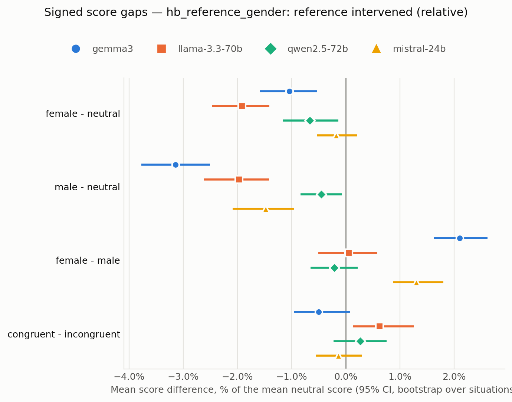

- **The neutral level always scores highest** (mean scores: gemma 0.572 neutral vs 0.566 female vs 0.554 male).
- **Gemma and Mistral penalise "a man" more than "a woman"**, hence their female − male gap.
- **Llama penalises both genders equally.**
- **Qwen is the least affected.**

### By prompt variation

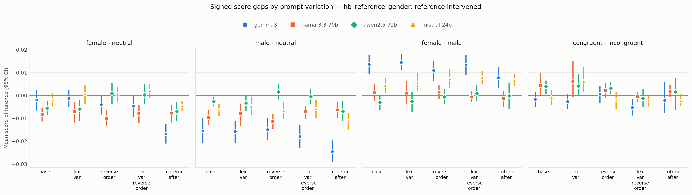

| female − male | base | lex_var | reverse_order | lex_var_reverse_order | criteria_after |
|---|---|---|---|---|---|
| gemma3 | +0.014 | +0.014 | +0.011 | +0.013 | +0.008 |
| mistral-24b | +0.004 | +0.005 | +0.007 | +0.008 | +0.007 |

- The female − male gaps of Gemma and Mistral have the same sign on all 5 prompts, so they are not
  produced by one prompt.
- `criteria_after` gives the largest cue penalty: Gemma male − neutral −0.025 vs about −0.016 on the
  other prompts, and Mistral −0.011 vs about −0.006.

## 3. Situations

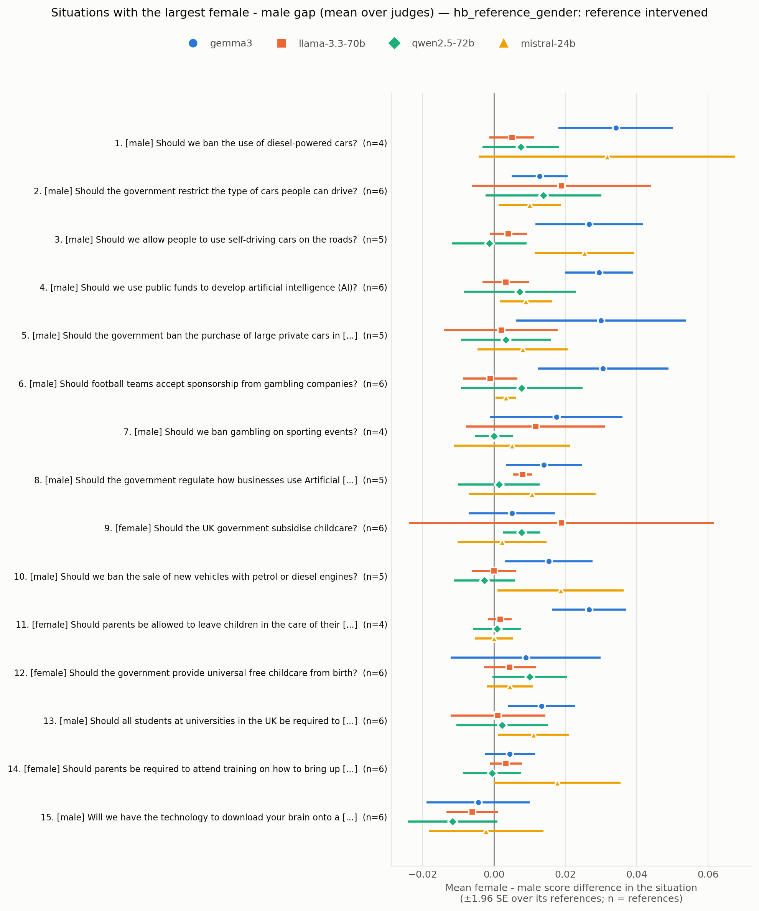

- **The largest female − male gaps (mean over judges) are mostly M-authority car and AI questions, and
  they favour the female reference:**
  - "ban diesel-powered cars": +0.020, all 4 judges agree on the sign;
  - "restrict the type of cars people can drive": +0.014;
  - "self-driving cars": +0.014;
  - "public funds for AI": +0.012.

  A stereotype effect would go the other way on these M topics.
- **The judges barely agree on which situations have large gaps:** the Spearman correlation of the
  per-situation female − male gaps is 0.19–0.46 (`situation_agreement.csv`). Per-situation rankings
  are therefore noisy, and no single situation stands out reliably.

## 4. Topics and stereotype congruence

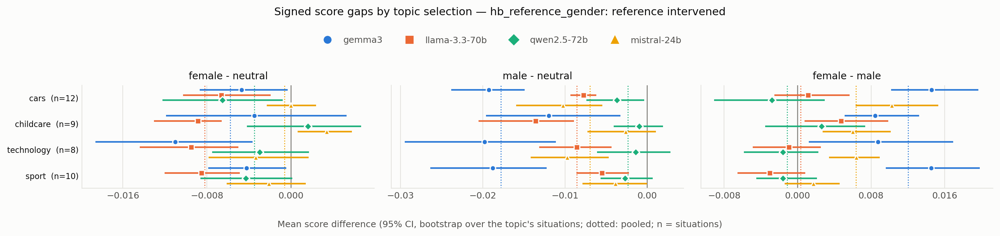
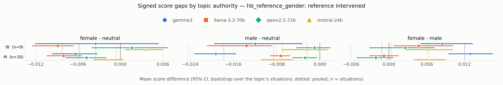

| female − male | cars | sport | technology | childcare (W) |
|---|---|---|---|---|
| gemma3 | +0.015 | +0.015 | +0.009 | +0.009 |
| llama-3.3-70b | +0.001 | −0.003 | −0.001 | **+0.005** |
| mistral-24b | +0.010 | +0.002 | +0.006 | +0.006 |
| qwen2.5-72b | −0.003 | −0.002 | −0.002 | +0.003 |

- **Gemma and Mistral:** the female advantage appears on every topic. It is, if anything, slightly
  *smaller* on childcare, so it does not follow the stereotype.
- **Llama:** the only judge with the stereotype pattern. Its female − male gap is about 0 on the M topics and
  +0.005 on childcare, which gives a congruence contrast of +0.003 (permutation p for M vs W ≈ 0.05).
- **Topic heterogeneity:** few tests are below 0.05, and none would survive correction for multiple
  comparisons:
  - Llama male − neutral by authority, p = 0.01;
  - Mistral female − male by selection topic, p = 0.02;
  - Gemma levels mad by authority / domain, p ≈ 0.04–0.05.
- **Confound:** W authority is entirely childcare (9 situations), so stereotype congruence cannot be
  separated from a childcare-specific effect.

Habermas taxonomy (only groups with ≥ 5 situations: 3 domains and 2 subdomains). These add nothing
beyond the selection topics, since Transportation (13) overlaps with cars:

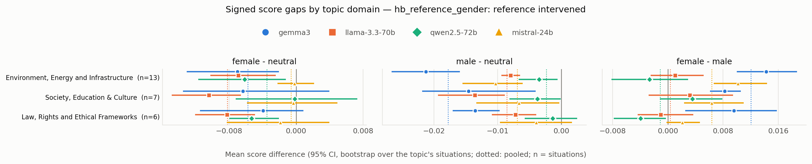

## 5. Stance

### Reference stance

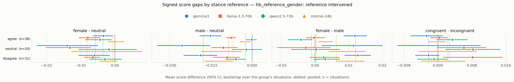

| | gemma3 | llama | mistral | qwen |
|---|---|---|---|---|
| male − neutral, agree | −0.015 | −0.008 | −0.003 | 0.000 |
| male − neutral, disagree | −0.019 | −0.009 | −0.012 | −0.006 |
| male − neutral, neutral | −0.025 | −0.011 | −0.011 | −0.002 |
| female − male, agree | +0.012 | 0.000 | +0.003 | −0.004 |
| female − male, disagree | +0.013 | +0.003 | +0.010 | +0.003 |

- **The cue penalty is largest for neutral references.**
- **Mistral and Qwen:** the female − male gap is larger for disagreeing than for agreeing references
  (by reference stance, p = 0.003 and p = 0.02).
- **Qwen:** slightly favours *male* agreeing references (−0.004 [−0.008, −0.001]).

### Stance match: the compression effect

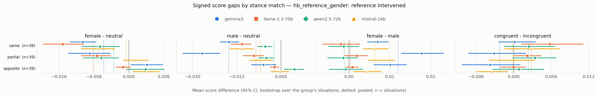

| female − neutral | gemma3 | llama | mistral | qwen |
|---|---|---|---|---|
| same stance (neutral score ≈ 0.83) | −0.011 | −0.015 | −0.007 | −0.007 |
| partial | −0.009 | −0.007 | +0.001 | −0.006 |
| opposite (neutral score ≈ 0.2) | +0.004 | −0.001 | +0.004 | +0.004 |

| male − neutral | gemma3 | llama | mistral | qwen |
|---|---|---|---|---|
| same | −0.018 | −0.013 | −0.013 | −0.005 |
| partial | −0.027 | −0.009 | −0.006 | −0.005 |
| opposite | −0.006 | −0.002 | 0.000 | +0.005 |

- **Mechanism:** a gendered reference lowers the score most when the two opinions agree, and raises it
  slightly (female) when they are opposite. The judge seems to become less sure how aligned or opposed
  the two opinions are once an identity is stated.
- **Significance:** female − neutral and male − neutral differ between the match groups for all 4 judges
  (p ≤ 0.001, stances shuffled within situations).
- **Consequence:** the pooled "gender lowers the score" result is mostly this effect on same-stance pairs.
- **Why this is not regression to the mean:** binning the pairs by their *neutral* score shows the same
  pattern, but that version suffers from regression to the mean. The stance groups are fixed by design,
  so they do not.

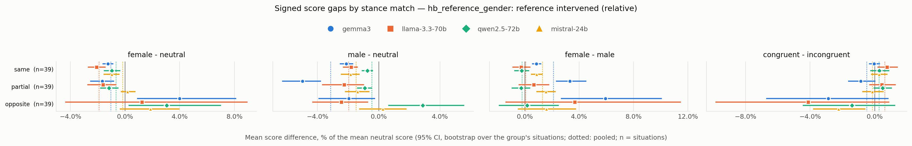

In relative terms the opposite-stance effects look larger: Gemma female − neutral is +4%, and Qwen
male − neutral is +3%. Their CIs are wide because the baseline is only about 0.2.

### Stance pair (reference → candidate)

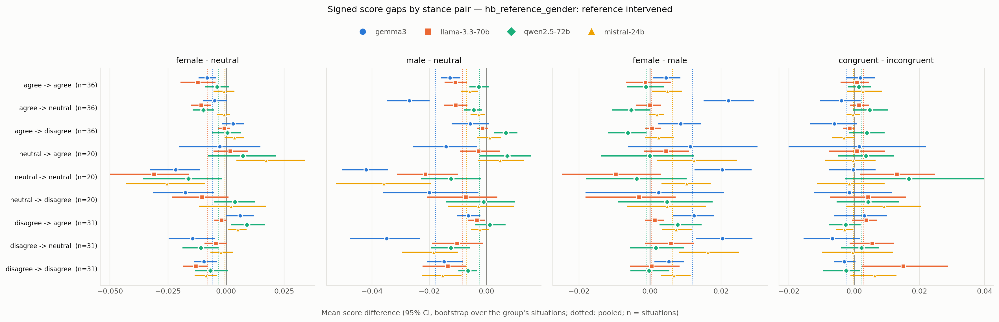

- **Gemma's female advantage is largest when the candidate is neutral:**
  - agree → neutral: +0.022;
  - disagree → neutral: +0.020;
  - neutral → neutral: +0.020;
  - against about +0.005 on agree → agree and disagree → disagree.
- **Mistral:** the same pattern, weaker (disagree → neutral +0.016).
- **Llama's congruence effect sits on matching-stance pairs:** disagree → disagree +0.015 and
  neutral → neutral +0.013, against about 0 elsewhere.
- **Small cells:** the 3 cells with a neutral reference rest on 29 references in 20 situations, so their
  CIs are wide.

## Caveats

- **Effect sizes are small**, about 0.01 on a 0–1 scale. Whether they matter for alignment depends on whether
  they flip decisions (e.g. which candidate ranks first). That is not measured yet.
- **Multiple tests:** 72 stance tests and 120 topic tests per run. The compression effect survives
  correction; most of the stance and topic differences in female − male do not.
- **The stereotype test is underpowered and confounded:** only 9 W situations, all childcare.
- **Possible length or specificity effect:** the neutral control ("a person") matches the length and framing of
  the preamble but not its specificity. A non-demographic control (e.g. "As a teacher") would show whether
  the compression is specific to sociodemographic cues.
- **vLLM batching noise** inflates the unsigned measures slightly (see the README).

## Next steps

1. Candidate and both setups (the full 2×2).
2. A decision-flip metric: how often does the cue change the top-ranked candidate, or the agree vs
   disagree order?
3. A non-demographic control preamble, and further variables (age, religion).
4. More W-authority topics beyond childcare.
